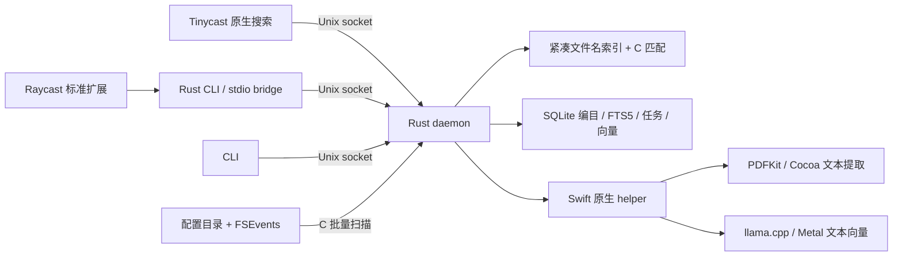

# Luminator 技术方案与第一版范围

设计日期：2026-10-12。本文保留完整 v0.1 目标；阶段 1 名称引擎已实现，实测与当前限制见 [阶段 1 报告](phase1-results.md)。正文、语义及客户端集成仍待实现。源码依据见 [复用清单](reuse-and-licensing.md)，验收见 [性能方案](performance-acceptance.md)。

## 1. 核心决定

建立独立 MIT 本地搜索引擎，保留 Tinycast 的启动器和扩展生态。Rust 负责目录编目、索引状态、任务调度、全文检索、向量检索、结果融合及本地接口；Oil Find 的 C 扫描/匹配代码和 DigUp 的 Swift 原生辅助能力作为可替换的实现组件。

第一版交付独立引擎、CLI、Tinycast 原生接入和 Raycast 标准扩展。Tinycast 核心只承担搜索入口、显示、选择和打开文件，不承担解析或模型推理。Rust 核心不是“把两个 Swift 应用整体包起来”，也不要求扫描和 Metal 推理都用 Rust 从零实现。

## 2. 第一版范围

| 范围 | 第一版行为 |
| --- | --- |
| 平台 | Apple Silicon，独立引擎 macOS 14+；Tinycast 接入 macOS 26+；暂不做 Intel / Windows / Linux |
| 文件名 | 配置目录内的文件和文件夹；名称/路径子串、英文大小写折叠、Unicode 规范化、中文、拼音全拼和首字母 |
| 基础筛选 | 目录、文件类型、扩展名；不一次搬入 Oil Find 全部高级查询语法 |
| 全文格式 | 有文本层的 PDF、DOCX、UTF-8 TXT / MD；DOCX 表格提取须通过样例验收，无法解析时明确标记 |
| 中文全文 | 连续中文中间词可检索，如“医院合作分工方案”可搜“合作分工”；不能只依赖英文 tokenizer |
| 语义 | 本地 EmbeddingGemma 2，文本检索；显示文件、片段、匹配类型和位置；不生成回答 |
| 增量 | 新增、修改、重命名、删除；FSEvents 历史恢复；大文件分步处理；失败文件不阻塞其它文件 |
| OneDrive / iCloud | 索引可见的名称元数据；只解析已下载的内容；占位目录不可遍历时说明覆盖缺口 |
| Tinycast | 主搜索直接显示文件/内容结果；保留 Search Files 详情入口和原有应用/命令行为 |
| Raycast | 一个标准 Search 命令，连接同一 daemon；可绑快捷键；不要求 Raycast Pro / AI API |
| 配置 | 文件名、全文、语义独立开关；目录包含/排除；索引状态、暂停与恢复；模型空闲释放 |

第一版不包含扫描 PDF OCR、图片/音频/视频语义、PPT/XLS、自动下载云文件、自动移动/归类/删除资料、问答 Agent、云端同步和通用第三方插件 SDK。语义命中只能引用提取到的原文，不伪造命中词或 DOCX 页码。

## 3. 进程与数据流

每个用户一份 daemon 和索引，多个客户端复用。首次安装不扫描整个磁盘；用户选定目录并开启后开始索引。客户端退出不必重建索引，模型 helper 空闲后退出释放权重。查询与后台编目分开排队，查询优先；后台 GPU 批次保持短小，不能让正在编码的长批次拖住输入。

进程通信选 Unix domain socket + UTF-8 JSON Lines，不开 TCP 端口。socket 放在用户私有运行目录。Swift helper 通过已有 DigUp worker 思路的 stdin/stdout 请求应答，stderr 独立记运行错误。第一版不另建 HTTP 服务或插件加载框架。

## 4. 文件编目与名称索引

1. Oil Find `sift_read_dir` 用 `getattrlistbulk` 读取名称、类型、大小、时间和文件标识，Rust 接收批次并管理遍历队列。
2. SQLite 保存权威文件目录和内容任务；内存 SoA 保存搜索热数据：UTF-8 名称池、偏移、parent ID、标志和拼音键。只为返回结果构建完整路径，避免每次查询创建百万个字符串。
3. SQLite 批量事务写入，内存索引在已提交批次后更新；启动从目录表恢复。第一版先不移植 Oil Find 的自定义持久化格式。若实测恢复不达标，再增加可重建快照缓存。
4. FSEvents 保存游标和卷身份；扫描期间缓冲事件并在结束后补扫。发生 dropped events、历史失效或根目录变化，重新扫描受影响范围。
5. 文件 ID 是本项目分配的稳定 ID，结合卷/设备、inode 和当前路径校验重命名；内容修改增加 generation。解析/向量结果写入前核对 generation，防止旧任务覆盖新内容或 inode 复用导致误关联。
6. 连续输入时只在同一索引版本、同一筛选、同一规范化域、查询单调延长时收窄候选；不得拿上一轮已显示的 Top 20 当作全部候选。

C FFI 的指针只在规定批次/快照生命周期内有效，Rust 不持有已失效的 C 缓冲区。32 位名称偏移到达容量上限时必须报告或分片，不能溢出。

阶段 1 使用单写入者顺序处理事件和查询，事务中同步更新内存，失败立即退出，重启从已提交 SQLite 恢复；尚未实现独立查询快照、候选缓存、内容 generation 或扫描时可查询。初扫记录开始前的事件游标，随后由 serve 重放扫描期间的历史事件。拼音和 FSEvents 采用小型 C 系统桥 + Rust 状态管理，无需先构建 Swift helper。

## 5. 全文、分块与语义

### 内容提取

从 DigUp 提取 PDFKit / Cocoa 相关代码形成小型 Swift helper，不引入 DigUpApp、Sparkle 或媒体界面。PDF 按页提取；DOCX 返回段落/文本偏移，不能保证与 Word 排版页码一致。TXT/MD 由 Rust 读取 UTF-8。扫描 PDF、加密或不支持编码的文档明确返回原因，名称搜索仍可用。

分块由 Rust 管理，先按 PDF 页/段落边界切分，再按模型 tokenizer 的 token 数控制大小，预留标题和任务提示预算，适量重叠。借鉴 DigUp 分步处理长文件的方式，但不照搬“1800 字符≈模型 token 预算”的假设。分块边界与定位随原文保存。

### 中文全文

使用 SQLite FTS5，不在第一版再引入 Tantivy。英文按词检索；中文建立预切分的相邻双字键，并保留单字键处理单字查询。查询对这些键求候选，再用原文验证连续子串及位置，避免仅有相同双字组合就被当作精确命中。键放在独立检索字段，原文保持不变，用于片段和高亮。

DigUp 当前的 `porter unicode61` 在连续中文中不保证中间子串召回；FTS5 内置 trigram 也不能单独满足两字中文查询。第一版要解决这一真实缺口。详见 [SQLite tokenizer 文档](https://www.sqlite.org/fts5.html#tokenizers)。

### 向量运行时

第一版直接复用并裁剪 DigUp `LlamaEmbedder` 和 llama.cpp 构建方案，由 Swift helper 包装，Rust 调度。使用 Q8_0 文本 GGUF、768 维、L2 归一化；不用图像/音频投影器。查询和文档分别使用官方 task prompt。

必须调整 DigUp 的 `textOnly` 设置：当前源码同时把 query context 缩至 512 tokens，不能直接把该模式拿来编码长文档。我们的 helper 将“只加载文本权重”和“查询/文档 token 预算”分开，查询 512、文档上限 2048；分块包含提示后仍须落在预算内。不能声称已经支持模型卡的 8192 tokens 全流程。

模型标识、revision、量化、向量维度、prompt、分块/解析版本随内容索引保存；不同配置不混用向量。改变这些参数只重新生成受影响的内容索引，不重扫无关名称。首次模型下载单独说明约 310 MB，优先国内镜像并校验来源版本，用户启用前不下载。

语义第一版的容量基准为 10 万片段：先用 FP16 连续向量缓冲区，Rust 通过小型 C ABI 调用 Accelerate 做精确检索，作为正确性和速度基线。10 万 × 768 × 2 = 153.6 MB 原始向量，尚不含模型和其它索引。

首版不强行引入 ANN。若 10 万片段的实测达不到延迟/内存目标，先测编码与扫描各自耗时，向量扫描确为瓶颈时引入 USearch/HNSW；必须相对精确检索验证 recall@10。百万片段容量不属于首版承诺。DigUp 的全量分数标准化不能未经校准直接套到 ANN 候选分布。

### 查询与融合

每次有效输入并行发起名称和全文；语义在输入稳定约 150 ms 后开始，取消过时请求。输入法组字期间不查询半成品。名称阶段采用短合并窗口（目标不超过 30 ms），不沿用 FileSearch 当前 120 ms 防抖来声称 100 ms 首屏。

名称精确匹配、前缀和高质量路径匹配单独置前，保留应用/命令的既有分组。全文 BM25 和语义候选用加权 RRF 融合，按文件聚合，展示最相关片段；同一文件不会因多个分块占满列表。RRF 是首版建议，不是 DigUp 已实现的算法。语义门槛在中文开发查询上校准，再在独立查询集验收；相似度不是“置信度百分比”。

名称结果先发布，全文和语义可以独立完成或失败。后到的结果不改变用户已选中的文件/命令身份，Enter 始终执行当前选中项。模型未安装或冷启动时展示名称/全文和明确状态，不先弹模型提示挡住输入。

## 6. 配置与本地接口

引擎配置保存在自己的 Application Support 目录；客户端通过引擎读取/更新，避免 Tinycast 和 Raycast 各自维护一份目录清单。名称目录和内容目录分开：可以给较大范围建名称索引，只对指定资料库建立全文/向量。

| 设置 | 含义 |
| --- | --- |
| names.enabled / roots / excludes | 名称编目范围和开关 |
| content.enabled / roots / excludes | 内容处理范围和开关 |
| semantic.enabled | 依赖 content；关闭后不生成或查询向量，退出模型 helper |
| indexing.paused | 暂停后台更新，保留现有可搜索结果并显示其状态 |
| model.idle_release_seconds | 默认目标 30 秒；正在索引时不算空闲 |
| Tinycast root integration | 只控制主搜索展示，不改变索引范围或 Raycast 使用 |

依赖规则：semantic 开启前必须启用 content；关闭 content 同时停其语义任务。关闭某能力立即从查询结果中撤下该能力并停止相关任务，已有缓存保留到用户主动清理；界面明确“关闭”与“清理已建索引”的区别。

本地接口只需支持 hello/capabilities、query/cancel、status、config 和 pause/resume。请求包含协议版本、request ID、query、scope、limit；分阶段响应包含 request ID、phase、done 和结果。结果至少包含 file ID、path、title、match kind、可选 snippet / locator 及内容状态。错误按能力返回，语义错误不能导致名称结果消失。

CLI 提供一次性 JSON 查询，以及 stdio bridge 到同一 daemon；它们不是独立索引器。Raycast 视图销毁只关闭连接，不关闭共享 daemon。状态最少显示：已编目数、内容待处理/完成/失败数、云占位缺口和模型状态，不把“扫描结束”当成“全部全文可搜”。

## 7. Tinycast 修改清单

以下路径相对 Tinycast 仓库，基于 `888b5e59fc39f62c7c42ad6ab42f689e6b233eeb`。本轮不修改该仓库。

| 位置 | 计划修改 |
| --- | --- |
| `Tinycast/App/AppCore.swift` | 唯一持有 EngineClient / 查询 session，管理启动与关闭；遵循现有 owner 规则，不增加 singleton |
| `Features/FileSearch/Service/FileSearchService.swift` | 增加 Luminator backend；保留原 Spotlight backend 供明确选择及引擎不可用时回退，显示所用 backend |
| `Features/FileSearch/Service/FileSearchSession.swift` | 从一次性数组改为按 request revision 接收阶段结果；取消旧任务；分别设名称/语义合并窗口 |
| `Features/FileSearch/Model/FileSearchResult.swift` | 增加可选匹配类型、片段、定位；Model 仍为纯数据，不引入 AppKit / SwiftUI |
| `Features/FileSearch/UI/FileSearchScreen.swift` | 显示片段、索引状态、匹配类型，保留现有预览和文件操作 |
| `Features/FileSearch/UI/FileSearchCoordinator.swift` | 复用打开、Finder 显示、复制路径；PDF 用原生预览定位页；外部默认阅读器不支持定位时打开文件并显示页号 |
| `Features/Launcher/UI/LauncherScreen.swift` | 增加独立文件结果 row；把它纳入平铺选择、主操作、次操作和菜单分发 |
| `Features/Launcher/UI/LauncherList.swift` | 增加文件/内容结果分组，与 screen 使用同一顺序和稳定 ID；不把片段硬塞进应用项 |
| `Palette/PaletteState.swift` 和其 launcher 消费方 | 处理异步插入后 selection 的稳定映射、输入法状态、窗口隐藏取消；当前 selection 是整数，不能只追加 UI 而不修正映射 |
| `Features/FileSearch/Settings/FileSearchSettingsView.swift` | backend、主搜索开关、能力开关、内容目录和状态入口 |
| `Features/Settings/AppSettings.swift` / `AppSettingsKey.swift` | 客户端展示/backend 偏好；引擎配置仍由引擎保存 |
| `Features/Settings/Model/SettingsFileKey.swift` / `SettingsFileSchema.swift` | 新增可镜像的客户端偏好；启用内容读取的授权不能因导入设置而自动获得 |

现有 `FallbackCoordinator` 的 Search Files 只是把 query 带入另一个页面，不能替代主搜索结果注入。统一搜索必须修改 LauncherScreen/List 的 row 和选择/执行路径；普通 Raycast 插件无法完成这个 Tinycast 核心变更。

主搜索优先保留应用、命令、计算器原有行为，文件组置于 fallback 之前，首屏上限建议 20 个文件；Search Files 详细页可看更多。初次没有应用/命令命中时，第一批名称结果可成为默认选中项；用户一旦导航或准备执行，后到结果保持选中身份。

不修改 Tinycast 的扩展加载器、应用索引、热键系统或受保护的滚动组件。适配 PR 遵循其功能文档和 harness；能回馈上游的目标是小型本地搜索 backend 接口与结果集成，不要求上游接收整套模型/索引代码。

## 8. Raycast 兼容边界

兼容承诺是“同一引擎 + 正式扩展 API”，不是修改 Raycast。TypeScript 扩展使用标准 `List`、`List.Section`、ActionPanel、open/reveal/copy 操作，通过 `onSearchTextChange` 请求；设置 `filtering={false}`，避免 Raycast 再按标题过滤掉语义结果。[List API](https://developers.raycast.com/api-reference/user-interface/list)

Raycast 的 Node 环境可用 `child_process.spawn` 维持当前视图的 stdio bridge，避免每次按键都冷启进程；引擎仍在外部 daemon 中。不要依赖扩展上下文长期存活来托管索引或权重。[扩展生命周期](https://developers.raycast.com/information/lifecycle)

按当前公开 API，没有通用的扩展搜索 provider 接口可把任意文件结果注入 Raycast 根搜索。因此 Raycast 需要进入 Search 命令或绑定快捷键；Tinycast 原生适配才提供无命令前缀的统一入口。这一差异需要在产品说明中公开。

兼容 Tinycast 的 Raycast 扩展运行器作为同包附加目标，但不能假设完整 Node 兼容：当前 `node-shims.js` 的 `net` 接口不可直接使用，`spawn` 在启动时收集 stdin，不等于可持续写入的 Node 子进程。初版同包兼容路径采用防抖后的 `execFile` 一次性 JSON 查询；这条路径不承诺阶段流式体验。Tinycast 主搜索始终走原生 socket 客户端。

验证应分别覆盖 Raycast 真机扩展、Tinycast 原生入口、同包扩展的 execFile 模式。不能把 Raycast SDK 编译通过写成“已兼容 Tinycast 全生态”。不使用 Raycast 内部接口或付费 AI 服务。

## 9. OneDrive 覆盖

Oil Find 和 DigUp 都会避开某些 dataless 内容，直接移植不可能自动补全云目录。第一版将“可遍历名称”和“内容已下载”分开统计。对不能枚举的占位目录，可选择 Spotlight 元数据补充名称，按路径/文件 ID 去重，并注明来源；不能据此标为全文已完成。

验收至少包含本地下载的文件、仅云端占位的文件和占位目录。已下载文件须能搜名称和正文；系统已有元数据的云端项目可补名称；系统未提供元数据且不可遍历的项目明确列为覆盖缺口，不能展示“全盘完整索引”。首次不自动触发下载。

## 10. 实施顺序与完成定义

| 阶段 | 可观察结果 |
| --- | --- |
| 方案仓库：已完成 | README、MIT、来源复用表、范围和验收目标 |
| 1：名称引擎：已实现 | CLI 搜合成百万条名称，增量/重命名/拼音与本机性能已验证；详见阶段 1 报告，云目录等扩展场景尚未验收 |
| 2：内容与语义 | 指定目录可全文检索；文本模型离线运行；返回真实片段/位置；中文留出集通过 |
| 3：两类入口 | Tinycast 主搜索无前缀出结果；Raycast 扩展访问同一索引；分别验证开关和选择稳定性 |
| 4：首版收口 | 发布可重现的性能/资源/质量报告和安装产物，公开第三方 notices |

阶段 1 只是可试用的名称里程碑，第一版完成仍须覆盖内容、语义、两类入口及验收。暂不承诺工期；最不确定的是中文语义质量、Swift helper 的文本模式改造及云占位覆盖。若这些不达标，报告缺口并调整实现，不用名称扫描 benchmark 代替用户体验。
